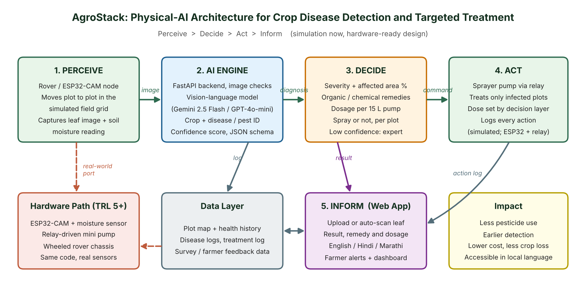

# AgroStack: AI Crop Disease Detection and Targeted Treatment

Team **United Coders** | TiH Hackathon: Physical AI, E-Summit'26, IIT Bombay | Track: IoT in Agriculture



## Problem
Crop diseases are usually detected late and treated by spraying whole fields with guessed doses.
This wastes pesticide, raises costs and harms soil and water.

## Solution
AgroStack closes the loop from perception to action:
1. **Perceive:** a rover or ESP32-CAM node captures a leaf image plot by plot.
2. **Decide:** the AI engine identifies the crop and disease; the decision layer picks severity, remedy and dosage.
3. **Act:** a sprayer treats only infected plots (simulated now; ESP32 + relay + pump on hardware).
4. **Inform:** the web app shows the result in English, Hindi and Marathi.

## Features
- Leaf image upload (JPEG, PNG, WebP, up to 10 MB) with strict validation
- Focus on Maharashtra's key crops: **Cotton, Soybean, Onion**
- Disease or pest identification with confidence score, severity level and affected-area percentage
- Organic and chemical remedies with dosage, plus preventive measures
- English, Hindi and Marathi interface
- Low-confidence or blurry images are escalated to the expert helpline (1800-180-1551) instead of guessed
- Strictly validated JSON responses (Pydantic schema)

## Tech Stack
- **Backend:** Python, FastAPI, Pydantic, Pillow
- **AI engine:** vision-language model (Google Gemini 2.5 Flash; OpenAI GPT-4o-mini supported)
- **Frontend:** single-page HTML, CSS and JavaScript (`index.html`)
- **Simulation:** Python grid-world of a field with a scouting rover and sprayer
- **Hardware path:** ESP32-CAM, soil-moisture sensor, relay-driven mini pump

## Project Structure
```
main.py            FastAPI backend (API + serves the frontend)
index.html         Web frontend (AgroStack Crop Disease Scanner)
requirements.txt   Python dependencies
.env.example       Environment variable template
```

## How to Run
```bash
git clone https://github.com/<your-username>/<repo-name>.git
cd <repo-name>
pip install -r requirements.txt
cp .env.example .env        # then add your GOOGLE_API_KEY
uvicorn main:app --host 0.0.0.0 --port 8000
```
Open http://localhost:8000 in your browser. API docs are at http://localhost:8000/docs.

### API
`POST /api/v1/diagnose` with a form field named `image`. Returns crop, disease, confidence,
severity, affected area, symptoms, remedies, Marathi translation and an escalation flag.
`GET /health` returns service status.

## Team
- Rigved Sathe
- Abhinav
- Dheeraj
- Jevesh

## Status
- Web app and API: working
- Rover and sprayer simulation: [in progress / done]
- Hardware prototype: planned for the Grand Finale
